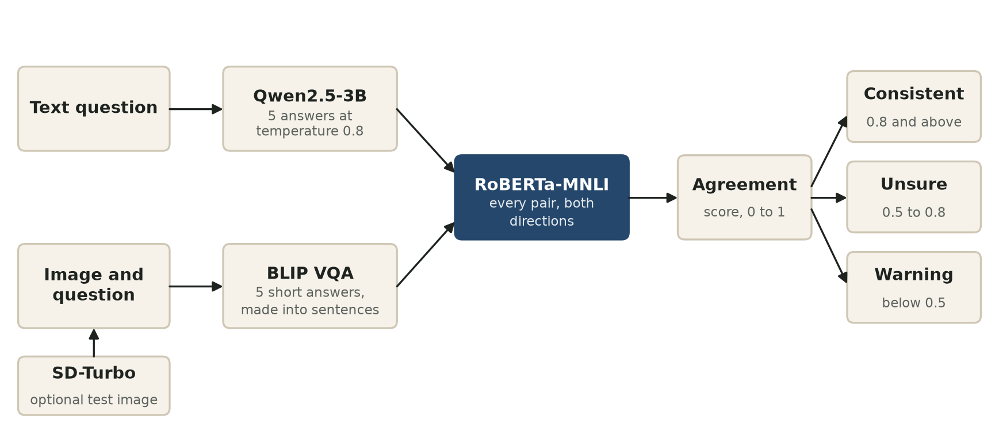
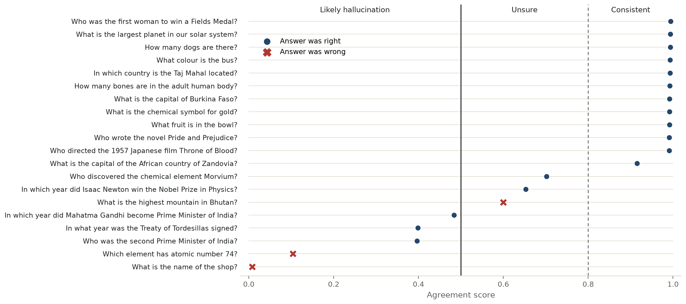

# Crosscheck: a self-consistency hallucination detector

A language model that knows a fact tends to repeat it. A model that is guessing changes
its story. Crosscheck asks the same question five times, compares the answers, and warns
you when they do not hold together.

**Live app:** https://somkex-hallucination-detector.hf.space

Generative AI mini project, problem P52. Swaraj Mandre, Roll No. 52.



## How it works

1. **Sample.** Qwen2.5-3B-Instruct answers the question five times at temperature 0.8.
2. **Compare.** RoBERTa-MNLI checks every pair of answers in both directions.
3. **Score.** The stronger direction becomes the pair score. Each answer's confidence is
   its mean pair score, and the agreement score is the mean of those.
4. **Warn.** Below 0.5 the app shows "Likely hallucination". From 0.5 to 0.8 it shows
   "Unsure". At 0.8 and above it shows "Consistent".

Image questions work the same way. BLIP answers five times, each short answer becomes a
sentence, and RoBERTa-MNLI compares them. SD-Turbo can make a test image if you have none.

## Results

Tested on 20 questions with answers written down in advance: 16 text and 4 image.

| Label shown to the user | Answer was right | Answer was wrong |
|---|---|---|
| Likely hallucination | 3 | 2 |
| Unsure | 2 | 1 |
| Consistent | 12 | 0 |

- Outcome correct on 16 of 20 questions (80%): 2 caught, 14 correct passes, 3 false alarms, 1 miss.
- All 12 answers labelled Consistent were right.
- About 2 seconds per check on an RTX 4060 laptop GPU.



The full table is in [evaluation/results/flagged_vs_wrong.csv](evaluation/results/flagged_vs_wrong.csv).

### Prompt styles compared

| Prompt style | Right answers (of 16) | Mean agreement | Wrong answers flagged |
|---|---|---|---|
| Direct | 14 | 0.76 | 1 of 2 |
| Few-shot | 14 | 0.86 | 0 of 2 |
| Cautious | 13 | 0.72 | 3 of 3 |

Few-shot examples made answers more uniform, and that hid errors as well. The cautious
prompt lost one right answer but made the wrong ones easier to spot.

### Known failure

With the few-shot prompt, all five answers said element 74 is technetium, at 0.98
agreement. It is tungsten. The model was consistently wrong, so a consistency check
cannot see the problem. This method measures agreement, not truth.

## Run it yourself

Needs Python 3.12 and a CUDA GPU. On a GPU with 8 GB, keep the image models on the CPU
as shown below.

```bash
git clone https://github.com/Swaraj-Mandre/Hallucination-Detector.git
cd Hallucination-Detector
python -m venv .venv
.venv\Scripts\activate
pip install -r requirements.txt
set VISION_DEVICE=cpu
python app.py
```

To repeat the evaluation:

```bash
python evaluation/make_images.py
python evaluation/run_evaluation.py
python evaluation/score.py
```

## Files

| File | What it does |
|---|---|
| `app.py` | The Gradio app |
| `ui.py` | Page design and the HTML for results |
| `detector.py` | Joins the steps and picks the verdict |
| `sampler.py` | Gets five answers from Qwen |
| `judge.py` | Scores agreement with RoBERTa-MNLI |
| `vision.py` | BLIP image questions and SD-Turbo test images |
| `config.py` | All settings and prompts |
| `evaluation/` | Test questions, runner, scoring and results |
| `MODEL_CARD.md` | Intended use, limits, licences and risks |

## Licence

The code is MIT licensed. The models keep their own licences, listed in the
[model card](MODEL_CARD.md). Qwen2.5-3B-Instruct is for research and study only.
